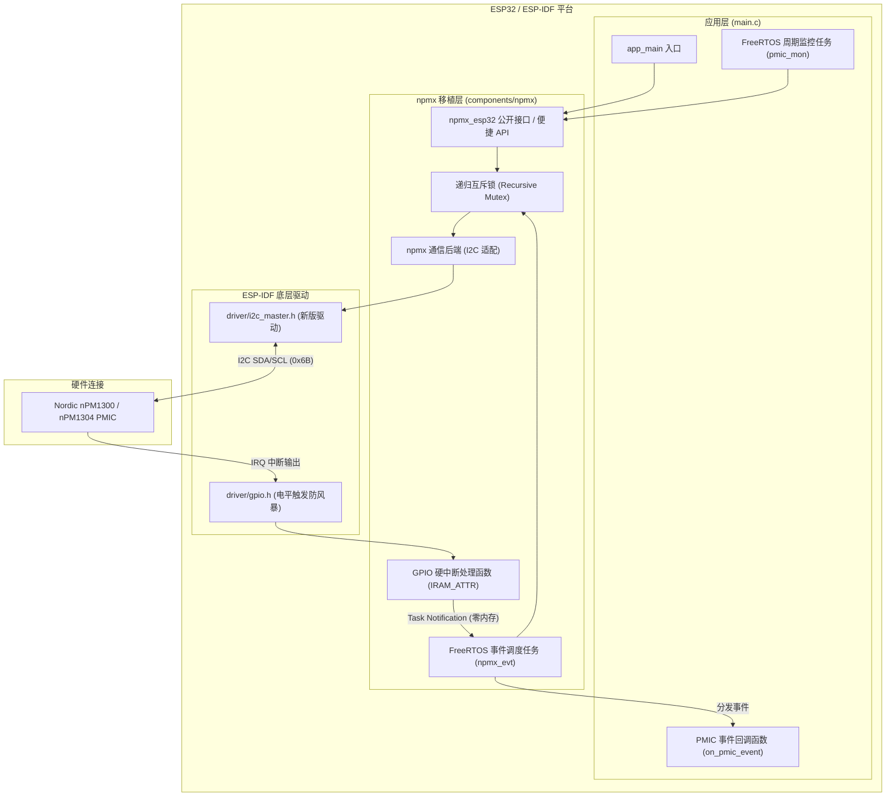

# ESP32-NPMX-FINALLY: Nordic nPM1300 / nPM1304 PMIC 移植最终综合版

本工程是 Nordic Semiconductor 官方电源管理芯片 **nPM1300 / nPM1304** 核心驱动库（`npmx`）在乐鑫 **ESP32 / ESP-IDF** 平台上的最终综合生产级移植实现。

综合汇聚了 **Antigravity**、**CodeBuddy**、**Qoder**、**TRAE CN** 四款代码的设计亮点，彻底剔除了 Zephyr RTOS 及原工程中的无关代码，修复了所有已发现的潜在并发死锁与超时计算缺陷，完全保留了第三方官方开源库的纯洁性，并遵照要求**不使用任何 Kconfig / idf.py menuconfig 选项**，所有引脚与运行参数均通过 C 语言宏（`#define`）统一配置。

---

## 一、综合优化与技术亮点

| 技术维度 | 其它方案存在的问题 | 本最终综合版（FINALLY）的解决方案 |
| :--- | :--- | :--- |
| **第三方库纯洁度** | Qoder 侵入式修改了 5 个 Nordic 官方驱动源文件 | **100% 保持官方上游源码未改动**；在 `CMakeLists.txt` 中通过 `-Wno-ignored-qualifiers` 解决 GCC 编译告警，完美支持后续 git submodule 更新。 |
| **并发与线程安全** | TRAE CN 采用非递归互斥锁，在嵌套调用或回调链中产生**死锁** | 采用 **FreeRTOS 递归互斥锁**（`xSemaphoreCreateRecursiveMutex`），多任务访问及中断嵌套彻底防死锁。 |
| **I2C 通信超时计算** | CodeBuddy 误用 `pdMS_TO_TICKS(100)`，导致 100Hz tick 下超时缩水至 10ms | 严格按照 ESP-IDF v5 规范直接传入**毫秒值**，确保各种工况下时钟拉伸与低功耗唤醒不超时。 |
| **中断与事件下半部** | 队列机制在突发中断时存在内存开销与满队列丢事件风险 | 采用 **FreeRTOS 任务通知 (Task Notification)** 传递事件位掩码（`NOTIF_INT` / `NOTIF_POF`），零动态内存开销，执行速度更快。 |
| **应用层便捷接口** | 部分方案将 ADC 采样锁死在 `main.c` 或完全未实现 | 封装了开箱即用的高阶接口：`npmx_esp32_vbat_get_mv()`、`npmx_esp32_vsys_get_mv()`、`npmx_esp32_die_temp_get_c()`、`npmx_esp32_dump_status()`。 |
| **规范性与依赖声明** | 部分方案在 `main/CMakeLists.txt` 中漏写了组件依赖 | 显式声明 `REQUIRES npmx`，工程结构规范统一。所有注释与日志全面中文化。 |

---

## 二、系统架构图



---

## 三、硬件接线参考说明

| nPM1300 / nPM1304 引脚 | ESP32 GPIO 推荐引脚 | 功能说明 |
| :--- | :--- | :--- |
| **SDA** | **GPIO 21** | I2C 数据总线（板上需外加上拉电阻 4.7kΩ 至 VIO） |
| **SCL** | **GPIO 22** | I2C 时钟总线（板上需外加上拉电阻 4.7kΩ 至 VIO） |
| **GPIO 0 (IRQ)** | **GPIO 4** | PMIC 硬件中断输出（默认高电平有效），连接 ESP32 中断引脚 |
| **GPIO 1 (POF)** | *(可选)* | PMIC 掉电预警 (PLW) 输出引脚 |
| **VIO / VDD** | **3.3V** | I/O 逻辑电平参考供电 |
| **GND** | **GND** | 系统共地 |
| **VBUS** | **USB 5V** | 外部 USB 供电与锂电池充电输入 |
| **VBAT** | **锂电池正极** | 单节可充电锂电池（标称 3.7V / 满充 4.2V）供电端 |

*(注：上述 GPIO 引脚编号可在 `npmx_esp32_config.h` 中灵活修改。)*

---

## 四、纯 `#define` 配置说明（无需 menuconfig）

配置文件路径：  
[`components/npmx/include/npmx_esp32_config.h`](file:///c:/Users/Administrator/Desktop/比较这四份代码Antigravity/ESP32-NPMX-FINALLY/components/npmx/include/npmx_esp32_config.h)

用户无需使用 `idf.py menuconfig`，直接编辑该头文件即可完成所有定制：

```c
/* 1. 目标芯片型号选择（1 为启用，0 为禁用） */
#define NPMX_DEVICE_NPM1300             1
#define NPMX_DEVICE_NPM1304             0

/* 2. I2C 总线参数配置 */
#define NPMX_ESP32_I2C_PORT             0          // 0 = I2C_NUM_0, 1 = I2C_NUM_1
#define NPMX_ESP32_I2C_SDA_GPIO         21         // SDA 引脚
#define NPMX_ESP32_I2C_SCL_GPIO         22         // SCL 引脚
#define NPMX_ESP32_I2C_ADDR             0x6B       // 7位 I2C 从机地址
#define NPMX_ESP32_I2C_FREQ_HZ          400000     // 400kHz 快速模式
#define NPMX_ESP32_I2C_TIMEOUT_MS       100        // 通信超时(ms)
#define NPMX_ESP32_I2C_INTERNAL_PULLUP  1          // 是否启用内部上拉

/* 3. 寄存器参数保留策略 */
#define NPMX_ESP32_RESTORE_VALUES       1          // 1=保留 PMIC 原有配置寄存器值

/* 4. 中断 (INT) 配置 */
#define NPMX_ESP32_INT_GPIO             4          // ESP32 中断输入引脚 (-1 为禁用)
#define NPMX_ESP32_PMIC_INT_PIN         0          // PMIC 侧 IRQ 输出 GPIO 编号 (0..4)
#define NPMX_ESP32_INT_ACTIVE_HIGH      1          // 1=高电平有效, 0=低电平有效

/* 5. 掉电预警 (POF) 配置 */
#define NPMX_ESP32_POF_GPIO             (-1)       // -1 表示未启用 POF
#define NPMX_ESP32_PMIC_POF_PIN         (-1)

/* 6. 事件调度任务参数 */
#define NPMX_ESP32_TASK_STACK_SIZE      4096       // 任务栈大小 (字节)
#define NPMX_ESP32_TASK_PRIORITY        10         // FreeRTOS 任务优先级
```

---

## 五、核心 API 使用指南

### 1. 初始化与反初始化
```c
#include "npmx_esp32.h"

// 方案 A：使用配置文件中的默认引脚创建总线并初始化
ESP_ERROR_CHECK(npmx_esp32_init_default());

// 方案 B：挂载到已有共享 I2C 总线上
// i2c_master_bus_handle_t shared_bus = ...;
// ESP_ERROR_CHECK(npmx_esp32_init(shared_bus));

// 获取官方驱动核心实例
npmx_instance_t *pmic = npmx_esp32_instance_get();
```

### 2. 状态查询与格式化打印
```c
// 一键在控制台输出 PMIC 版本、BUCK 输出、充电状态与 VBUS 状态
npmx_esp32_dump_status();
```

### 3. 便捷 ADC 遥测采样
```c
int32_t vbat_mv = 0;
if (npmx_esp32_vbat_get_mv(&vbat_mv) == NPMX_SUCCESS) {
    ESP_LOGI("APP", "电池电压: %ld mV", vbat_mv);
}

int32_t vsys_mv = 0;
if (npmx_esp32_vsys_get_mv(&vsys_mv) == NPMX_SUCCESS) {
    ESP_LOGI("APP", "系统供电电压: %ld mV", vsys_mv);
}

float die_temp_c = 0.0f;
if (npmx_esp32_die_temp_get_c(&die_temp_c) == NPMX_SUCCESS) {
    ESP_LOGI("APP", "PMIC 芯片结温: %.2f ℃", die_temp_c);
}
```

### 4. 注册硬件事件中断
```c
static void on_pmic_event(npmx_instance_t *p_pm, npmx_callback_type_t type, uint8_t mask)
{
    ESP_LOGI("APP", "收到事件: %s, 掩码: 0x%02X", npmx_callback_to_str(type), mask);
}

// 注册 VBUS 插入/拔出事件
npmx_esp32_register_cb(NPMX_CALLBACK_TYPE_EVENT_VBUSIN_VOLTAGE, on_pmic_event);
npmx_esp32_event_interrupt_enable(
    NPMX_EVENT_GROUP_VBUSIN_VOLTAGE,
    NPMX_EVENT_GROUP_VBUSIN_DETECTED_MASK | NPMX_EVENT_GROUP_VBUSIN_REMOVED_MASK);
```

---

## 六、编译与烧录

确保已激活 ESP-IDF 环境（推荐 ESP-IDF v5.1 / v5.2 / v5.3 / v5.4+）：

```bash
# 1. 设置目标芯片为 ESP32 (若使用 ESP32-S3 则设为 esp32s3)
idf.py set-target esp32

# 2. 编译工程
idf.py build

# 3. 烧录并打开串口监视器 (请将 COMx 替换为实际串口号)
idf.py -p COMx flash monitor
```

---

## 七、工程目录结构说明

```
ESP32-NPMX-FINALLY/
├── CMakeLists.txt                      # 顶层 CMake 工程规则
├── README.md                           # 本工程完整技术文档
├── sdkconfig                           # ESP-IDF 系统配置
├── components/
│   └── npmx/                           # PMIC 移植组件
│       ├── CMakeLists.txt              # 组件 CMake 构建规则 (包含告警抑制)
│       ├── npmx_esp32.c                # 移植层核心实现 (I2C后端/中断/互斥锁/ADC)
│       ├── include/
│       │   ├── npmx_esp32.h            # 对外导出的统一 C API 头文件
│       │   └── npmx_esp32_config.h     # 纯 #define 硬件配置头文件
│       ├── port/                       # Nordic npmx 官方移植胶水目录
│       │   ├── npmx_config.h           # 器件型号桥接头文件
│       │   ├── npmx_config_npm1300.h   # nPM1300 配置标识
│       │   ├── npmx_config_npm1304.h   # nPM1304 配置标识
│       │   └── npmx_glue.h             # 断言与环境适配胶水
│       └── npmx/                       # Nordic 官方 upstream 驱动库 (100% 保持纯洁)
│           ├── adk/                    # 寄存器与位域定义
│           ├── backends/               # 官方通信抽象接口
│           └── drivers/                # BUCK/充电器/ADC/LDSW/LED 等外设驱动
└── main/
    ├── CMakeLists.txt                  # 主应用 CMakeLists.txt (显式依赖 npmx)
    └── main.c                          # 生产级综合演示主程序 (全生命周期管理)
```
